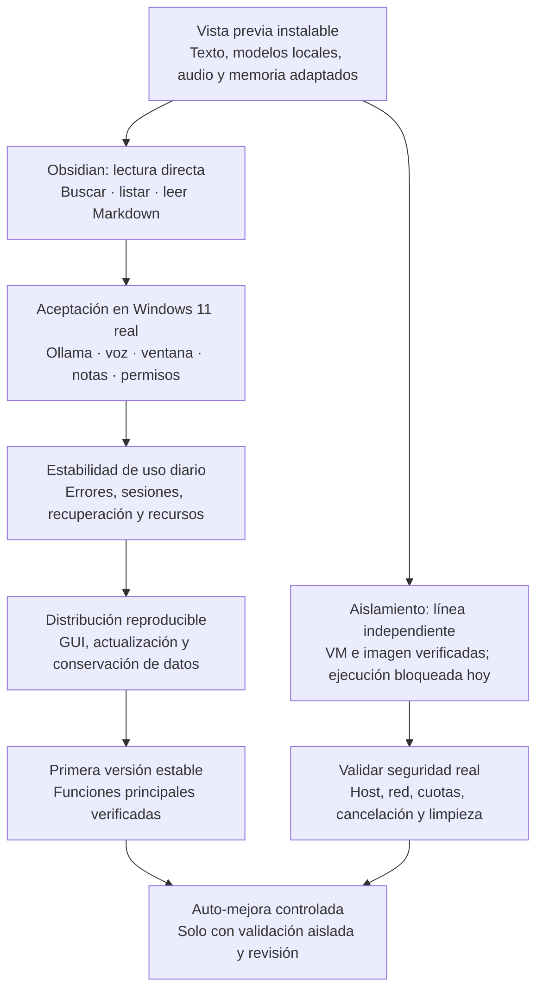

# Bridget en Windows: situación y próximas metas

Bridget está en una vista previa instalable. Hay evidencia automatizada en
Windows Server (293 pruebas) y Linux (288 aprobadas, 5 omitidas), incluidas
consultas Obsidian desde la consola real; todavía no es una versión estable validada en Windows
11 físico. La línea principal busca que el asistente cotidiano funcione sin
necesitar ejecución dinámica. El sandbox conserva su bloqueo.

## Qué está comprobado y qué falta

| Área | Situación actual | Próxima comprobación o entrega |
| --- | --- | --- |
| Instalación | Text y Voice con locks/hashes; instalador y smoke en CI Windows. GUI se instala/importa, pero parte de su build no está fijada por hashes. | Instalar en Windows 11 con usuario estándar; preparar wheelhouse GUI y actualizar conservando datos. |
| Conversación | Cliente Ollama local, modelos configurables y CLI que tolera fallos. | Usar modelos reales, probar streaming y medir RAM/VRAM/latencia en la PC destino. |
| Obsidian | Consultas explícitas de solo lectura separadas del sandbox, filtros comunes y prueba real de consola con vault sintético. | Repetir con vault de prueba en Windows 11 antes de acceder a notas personales. |
| Memoria | Persistencia y matemática semántica probadas con datos sintéticos. | Recuperación con embeddings reales, backup/restauración, reindexado al cambiar modelo y evitar dos procesos sobre el mismo estado. |
| Voz y audio | PortAudio portable; SAPI genera WAV en Windows Server; imports STT aprobados. | Micrófono/parlantes reales, español, eco, interrupción, permisos y cambios de dispositivo. Coqui/CUDA requieren perfil propio. |
| Escritorio y apps | Ventana preparada; allowlist y confirmación de apertura probadas con dobles; FAILSAFE activo. | WebView2 visible, notificaciones, DPI/monitores y abrir/cancelar/revocar aplicaciones en Windows 11. |
| Extras | API/push y conversión de documentos conservados como perfiles opcionales. | Validar autenticación, exposición de red y runtimes de documentos antes de incorporarlos a la distribución estable. |
| Linux | Pruebas y smoke de texto siguen pasando en CI. | Mantener regresión en cada cambio y comprobar audio/escritorio Linux con dispositivos. |
| Código generado | Ejecución bloqueada. QEMU/WHPX sigue experimental y no se activa automáticamente. | Imagen limpia, endurecimiento host y pruebas reales de aislamiento; recién después, revisar su habilitación. |

## Orden de trabajo

1. Cerrar errores funcionales reproducibles como el enrutamiento de Obsidian.
2. Ejecutar la matriz de [Windows 11](WINDOWS11.md) y registrar resultados sin
   claves ni datos personales. Esa evidencia determina qué corregir primero.
3. Estabilizar el uso diario: conversación, notas, voz, permisos y recuperación
   del estado. Una instalación que termina bien no prueba todavía esta etapa.
4. Completar distribución/actualización reproducibles y publicar una primera
   versión estable cuando cumpla la matriz de aceptación definida.
5. Continuar el aislamiento en paralelo, sin que bloquee el asistente cotidiano
   ni se omitan sus controles para avanzar con auto-mejora.

No hay fechas comprometidas: la validación física y los fallos que aparezcan
marcan el ritmo. [MIGRATION_PLAN.md](../MIGRATION_PLAN.md) registra cambios y
resultados; [QEMU_BACKEND.md](QEMU_BACKEND.md) detalla la línea de aislamiento.
